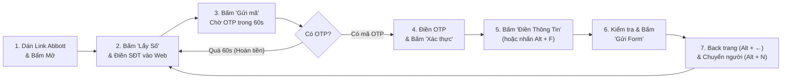

# 🏥 Abbott Event Helper — Hệ Sinh Thái Hỗ Trợ Đăng Ký Sự Kiện & Hội Thảo Abbott

> **Bộ công cụ chuyên dụng giúp tự động hóa quy trình thuê SIM nhận OTP, chuẩn hóa danh sách Nhân viên Y tế và tự động điền (Auto-fill) biểu mẫu đăng ký sự kiện, hội thảo trực tuyến của Abbott trên Windows, Android, Telegram và Trình duyệt.**

[](https://flutter.dev)
[](https://python.org)
[](https://playwright.dev)
[](#)

---

## 📌 Mục Lục

1. [Ứng dụng này dùng để làm những gì?](#-1-ứng-dụng-này-dùng-để-làm-những-gì)
2. [Tổng quan 4 công cụ trong dự án](#-2-tổng-quan-4-công-cụ-trong-dự-án)
3. [Quy chuẩn định dạng dữ liệu đầu vào (`NOIDUNGDIEN.TXT`)](#-3-quy-chuẩn-định-dạng-dữ-liệu-đầu-vào)
4. [Hướng dẫn sử dụng Ứng dụng Flutter (Windows & Android)](#-4-hướng-dẫn-sử-dụng-ứng-dụng-flutter-windows--android)
5. [Hướng dẫn sử dụng Telegram Bot (`@abbott_fill_bot`)](#-5-hướng-dẫn-sử-dụng-telegram-bot-abbott_fill_bot)
6. [Hướng dẫn sử dụng Công cụ Python Desktop (`PyQt5` & `Playwright`)](#-6-hướng-dẫn-sử-dụng-công-cụ-python-desktop)
7. [Hướng dẫn sử dụng Tiện ích Chrome / Edge Extension](#-7-hướng-dẫn-sử-dụng-tiện-ích-chrome--edge-extension)
8. [Cấu trúc thư mục dự án](#-8-cấu-trúc-thư-mục-dự-án)
9. [Xử lý sự cố thường gặp (FAQ)](#-9-xử-lý-sự-cố-thường-gặp-faq)

---

## 🎯 1. Ứng Dụng Này Dùng Để Làm Những Gì?

Khi tham gia các buổi hội thảo, sinh hoạt khoa học của **Abbott**, ban tổ chức thường cung cấp một đường link hoặc mã QR điểm danh/đăng ký có **giới hạn thời gian ngắn (`overTime`)** và **yêu cầu xác thực vị trí GPS + mã OTP số điện thoại** cho từng Y Bác sĩ, Điều dưỡng, Dược sĩ. Việc nhập tay cho danh sách hàng chục nhân viên y tế rất dễ sai sót và không kịp thời gian.

Dự án **Abbott Event Helper** giải quyết triệt để bài toán trên bằng cách tự động hóa **5 nghiệp vụ cốt lõi**:

### 🔹 1. Mở cổng sự kiện & Giả lập vị trí GPS hợp lệ (Geolocation Spoofing)
- Cổng đăng ký của Abbott yêu cầu người dùng phải đang có mặt tại tọa độ của bệnh viện mới cho phép mở form.
- Ứng dụng tích hợp trình duyệt nhúng tự động ghi đè tọa độ GPS (`Latitude: 15.114757, Longitude: 108.791015` — Bệnh viện Đa khoa Tỉnh Quảng Ngãi), giúp mở link sự kiện ở bất kỳ đâu mà không bị chặn vị trí.

### 🔹 2. Thuê SIM & Nhận mã OTP tự động đa nguồn (ViOTP & HupSMS)
- Tích hợp song song 2 nhà cung cấp SIM OTP phổ biến nhất: **ViOTP** (`api.viotp.net`) và **HupSMS** (`hupsms.com`), chuyển đổi qua lại chỉ với 1 chạm.
- **Chọn Server thông minh trên HupSMS**: Tự động dò và sắp xếp các cụm Server Abbott theo mức giá từ thấp đến cao (`Server 247` giá **1.500đ** ⭐ rẻ nhất, `Server 3` giá **1.800đ**, `Server 2` giá **3.500đ**). Dễ dàng đổi Server ngay khi một kho hết số.
- **Đồng hồ đếm ngược 60 giây & Tự động hoàn tiền**: Khớp chính xác 1:1 với thời gian chờ 60s của website Abbott. Nếu sau 60s tin nhắn OTP không về hoặc người dùng bấm dừng, hệ thống **tự động hủy đơn để hoàn lại 100% tiền** vào tài khoản HupSMS.

### 🔹 3. Chuẩn hóa danh sách Nhân viên Y tế tự động
- Chỉ cần dán danh sách thô (viết tắt, có dấu hoặc không dấu lộn xộn như `bs`, `đd`, `gây mê`, `ngoại tk`...), hệ thống tự động phân tích và quy đổi sang **đúng tên Khoa/Phòng ban và Chức danh chuẩn trong menu dropdown của Abbott** (ví dụ: `bs` $\rightarrow$ `Bac Sy Dieu Tri`, `gây mê` $\rightarrow$ `Khoa Phau Thuat Gay Me - Hoi Suc`).
- **Xử lý thông minh trường "Phòng ban (Khác)"**: Nếu tên khoa của nhân viên không nằm trong 30 khoa mặc định của Abbott, ứng dụng tự động chọn mục `Khac` trên dropdown và tự động điền tên khoa thực tế vào ô nhập tay **Phòng ban (Khác)** vừa xuất hiện.

### 🔹 4. Quản lý Profile Bệnh viện & Gán nhanh 1-chạm
- Lưu trữ danh sách các Bệnh viện thường xuyên làm sự kiện (BV Đa khoa Tỉnh Quảng Ngãi, BV Sản Nhi, BV Phúc Hưng, BV Nội Tiết...).
- Hỗ trợ chọn Bệnh viện mặc định cho cả đoàn bằng nút **Gán BV cho tất cả** hoặc tùy chỉnh Bệnh viện riêng cho từng cá nhân trong danh sách.

### 🔹 5. Tự động điền biểu mẫu (Auto-fill) 2 giai đoạn & Kiểm soát an toàn
- **Giai đoạn 1 (Trang Xác thực SĐT/OTP)**: Tự động điền SĐT vừa thuê, tự bấm nút *"Gửi mã"*, tự bắt mã OTP khi tin nhắn về và điền vào ô *"Mã xác thực"*.
- **Giai đoạn 2 (Trang Thông tin cá nhân)**: Tự động điền tuần tự **Họ và tên**, chọn dropdown **Vai trò** (`Nguoi tham du`), **Bệnh viện**, **Phòng ban / Khoa** (kèm **Phòng ban Khác**), **Chức danh**, và tự động tích chọn **Checkbox Đồng ý điều khoản quyền riêng tư**.
- **An toàn thao tác**: Hỗ trợ cấu hình độ trễ (`delay ms`) cho từng trường để tương thích mọi tốc độ mạng, kèm bảng **Sao chép nhanh 1-chạm** và chế độ để người dùng kiểm tra lần cuối trước khi bấm Gửi.

---

## 🧰 2. Tổng Quan 4 Công Cụ Trong Dự Án

Dự án cung cấp **4 giải pháp** phù hợp với từng thiết bị và phong cách vận hành khác nhau:

| Công cụ | Thư mục | Nền tảng | Đặc điểm & Khi nào nên dùng? |
|---|---|---|---|
| **1. Abbott Event Helper (Flutter App)** ⭐ *(Khuyên dùng)* | [`abbott_flutter_app/`](abbott_flutter_app/) | **Windows Desktop** & **Android APK** | Giao diện **Split-View** hiện đại (Sidebar điều khiển bên trái + WebView2 bên phải). Hỗ trợ cả ViOTP & HupSMS, phím tắt nhanh (`Alt+F`, `Alt+N`), kiểm soát trực quan từng người. |
| **2. Abbott Telegram Bot** (`@abbott_fill_bot`) | [`abbott_tele_bot/`](abbott_tele_bot/) | **Telegram** (Chạy trên PC / Server / Docker) | Điều khiển hoàn toàn qua chat Telegram. Hỗ trợ **quét ảnh mã QR**, tính giờ hết hạn link, chạy hàng đợi tự động ngầm bằng Playwright và **chụp ảnh màn hình thẻ form gửi về Telegram** để duyệt trước khi nộp. |
| **3. Python Desktop Helpers** | [`python/`](python/) | **Windows / macOS / Linux** (Python) | Gồm bản giao diện **PyQt5** ([`abbott_helper.py`](python/abbott_helper.py)) và bản **Tkinter + Playwright Chrome** ([`abbott_chrome_helper.py`](python/abbott_chrome_helper.py)). Đọc/ghi trực tiếp file [`NOIDUNGDIEN.TXT`](python/NOIDUNGDIEN.TXT) và xuất file chuẩn hóa. |
| **4. Chrome / Edge Extension** | [`extension/`](extension/) | **Chrome / Edge** (Manifest V3) | Tiện ích gắn trực tiếp trên trình duyệt Chrome/Edge, kết hợp với **GeoSpoof**. Hỗ trợ kéo thả ảnh QR vào popup và kiểm tra khoảng cách GPS (`<= 350m`) trước khi điền. |

---

## 📝 3. Quy Chuẩn Định Dạng Dữ Liệu Đầu Vào

Tất cả các công cụ trong dự án đều sử dụng chung một chuẩn định dạng văn bản cho danh sách người tham dự (mỗi người nằm trên 1 dòng, phân tách bởi dấu gạch ngang `-`):

### 3.1. Cú pháp tiêu chuẩn
```text
Họ và tên - Khoa/Phòng ban - Chức danh [- Tên Bệnh viện (tùy chọn)]
```

**Ví dụ đầu vào thô (có thể viết thường, viết tắt, có dấu hoặc không dấu):**
```text
Phạm Thị Thu Vân - gây mê hồi sức - bs
Huỳnh Thị Việt Trinh - ngoại thần kinh - điều dưỡng
Nguyễn Thị Kim Thuỳ - ngoại thần kinh - điều dưỡng trưởng
Võ Thị Diệu Thanh - nội tổng hợp - bs - BENH VIEN SAN NHI TINH QUANG NGAI
```

### 3.2. Cú pháp dành cho "Khoa Khác" (Ngoài danh mục mặc định)
Khi nhân viên thuộc khoa không có sẵn trong danh sách dropdown của Abbott, bạn có thể nhập trực tiếp tên khoa đó hoặc dùng cú pháp tường minh:
```text
Họ và tên - Khoa Khác - Tên khoa thực tế - Chức danh [- Tên Bệnh viện]
```
*Ví dụ:*
```text
Nguyễn Văn An - Khoa Khác - Khoa Lão học - bs
Trần Thị Bình - Khoa Nhi Sơ Sinh - điều dưỡng
```
> 💡 Hệ thống sẽ tự động chọn `Khac` ở menu Phòng ban và tự điền `Khoa Lão học` / `Khoa Nhi Sơ Sinh` vào ô **Phòng ban (Khác)** trên web.

### 3.3. Bảng quy tắc tự động chuẩn hóa tiêu biểu

| Dữ liệu nhập thô | Kết quả chuẩn hóa trên Form Abbott |
|---|---|
| `bs`, `bác sĩ`, `bac sy`, `bác sĩ điều trị` | `Bac Sy Dieu Tri` |
| `dd`, `điều dưỡng`, `y tá`, `y ta` | `Y ta/ Dieu duong` |
| `điều dưỡng trưởng`, `y tá trưởng`, `...trưởng` | `Y Ta Truong/ Dieu Duong Truong` |
| `dược sĩ`, `duoc sy` | `Duoc sy` |
| `trưởng khoa`, `phó khoa`, `giám đốc`, `phó giám đốc` | `Truong Khoa`, `Pho Khoa`, `Giam Doc`, `Pho Giam Doc` |
| `gây mê`, `gây mê hồi sức`, `pt gmhs` | `Khoa Phau Thuat Gay Me - Hoi Suc` |
| `ngoại thần kinh`, `ngoai tk` | `Khoa Ngoai Than Kinh` |
| `chấn thương`, `chỉnh hình`, `bỏng` | `Khoa Chan Thuong Chinh Hinh - Bong` |
| `nội tổng hợp`, `ngoại tổng hợp` | `Khoa Noi Tong Hop`, `Khoa Ngoai Tong Hop` |
| `nội tiêu hóa`, `ngoại tiêu hóa`, `nội tim mạch` | `Khoa Noi Tieu Hoa`, `Khoa Ngoai Tieu Hoa`, `Khoa Noi Tim Mach` |

---

## 💻 4. Hướng Dẫn Sử Dụng Ứng Dụng Flutter (Windows & Android)

Đây là ứng dụng chính thức và đầy đủ tính năng nhất, nằm tại thư mục [`abbott_flutter_app/`](abbott_flutter_app/).

### 4.1. Cài đặt & Khởi chạy
- **Bản đóng gói sẵn (Người dùng cuối)**:
  - **Windows**: Giải nén file `abbott_helper-windows-x64.zip` và chạy trực tiếp `abbott_helper.exe`.
  - **Android**: Cài đặt file `abbott_helper-v1.4.0.apk` lên điện thoại.
- **Chạy từ mã nguồn (Dành cho Developer)**:
  ```bash
  cd abbott_flutter_app
  flutter pub get
  flutter run -d windows   # Hoặc: flutter run -d android
  ```

### 4.2. Thiết lập lần đầu (Trong nút ⚙️ Cài đặt)
Bấm vào biểu tượng **Cài đặt** ở góc trên bên phải màn hình để mở hộp thoại quản lý 3 ngăn:
1. **Tab `Cấu Hình`**:
   - Chọn nguồn OTP mặc định: **ViOTP** hoặc **HupSMS**.
   - Nhập **ViOTP Token** (lấy tại `viotp.net`) và bấm **Dò ViOTP**, hoặc nhập **HupSMS API Key** (lấy tại `hupsms.com/profile`) và bấm **Dò HupSMS**.
   - Chọn **Thời gian chờ OTP**: Mặc định `60 giây` (chuẩn của Abbott).
   - **Cấu hình trường tự điền & Độ trễ (`ms`)**: Bật/tắt từng trường cần điền và chỉnh độ trễ mở dropdown (mặc định `700ms`, riêng trường Bệnh viện `1800ms` để đợi danh sách bệnh viện tải xong).
2. **Tab `Bệnh Viện`**:
   - Thêm mới hoặc bấm **Nhập nhiều** để lưu danh sách các bệnh viện vào Profile.
   - Chọn **Bệnh viện mặc định** và bấm **Gán BV này cho TẤT CẢ** nếu cả danh sách cùng thuộc một bệnh viện.
3. **Tab `DS Người`**:
   - Dán danh sách người tham gia vào ô văn bản và bấm **Phân tích & Thêm vào DS**.
   - Kiểm tra hoặc chỉnh sửa trực tiếp từng thẻ người (Họ tên, Khoa, Phòng ban Khác, Chức danh, Bệnh viện) rồi bấm **Lưu Thay Đổi**.

### 4.3. Quy trình vận hành chuẩn (SOP 7 Bước)



1. **Mở link sự kiện**: Dán URL sự kiện Abbott vào thanh địa chỉ trên cùng và nhấn **Enter** / **Mở**.
2. **Thuê số & Gửi mã**:
   - Kiểm tra nguồn OTP (`ViOTP` / `HupSMS`) và nút **`Server ID`** trên thẻ điều khiển.
   - Bấm **`[ 📱 Lấy Số ]`** $\rightarrow$ Số điện thoại được tự động copy vào Clipboard.
   - Bấm nút **Dán & Gửi mã** (biểu tượng `📋` cạnh SĐT) để ứng dụng tự điền SĐT vào web, tự bấm nút *"Gửi mã"* trên web và tự động kích hoạt bộ đếm ngược chờ OTP 60s (hoặc dán tay `Ctrl + V` vào web rồi bấm **`[ ✉ Lấy OTP ]`**).
3. **Nhận OTP & Xác thực**:
   - Khi có mã OTP, ứng dụng **tự động copy vào Clipboard và tự động điền vào ô Mã xác thực** trên web.
   - *(Nếu quá 60s chưa có mã hoặc bạn bấm nút **Dừng**, ứng dụng sẽ tự hủy đơn hoàn tiền trên HupSMS để bạn bấm **Lấy Số** khác).*
   - Bấm nút **Xác thực** trên trang web để chuyển sang trang biểu mẫu thông tin.
4. **Tự động điền thông tin cá nhân**:
   - Kiểm tra tên người đang chọn trên thẻ (ví dụ `#1/9 Phạm Thị Thu Vân`). Có thể bấm vào huy hiệu `#1/9` để mở danh sách chọn nhanh bất kỳ người nào.
   - Bấm nút **`[ 🪄 Điền Thông Tin ]`** (hoặc nhấn phím tắt **`Alt + F`**). Ứng dụng sẽ tự động điền Họ tên, Vai trò, Bệnh viện, Khoa/Phòng ban, Chức danh và tích Checkbox đồng ý.
5. **Kiểm tra & Nộp biểu mẫu**:
   - Quan sát nhanh các trường trên web đã hiển thị đầy đủ, sau đó bấm nút **`[ 🚀 Gửi Form ]`** (hoặc bấm nút *Gửi* trực tiếp trên web).
6. **Chuyển người tiếp theo**:
   - Nhấn **`Alt + ←`** (hoặc nút Back trên thanh trình duyệt) để quay về trang nhập SĐT ban đầu.
   - Nhấn **`Alt + N`** (hoặc nút `>`) để chuyển sang người kế tiếp và lặp lại từ Bước 2.

### 4.4. Bảng phím tắt tốc độ cao trên Windows

| Phím tắt | Tác dụng |
|---|---|
| **`Alt + F`** | Tự động điền thông tin người hiện tại vào Form web (**Auto-fill**) |
| **`Alt + N`** | Chuyển sang người tham dự **tiếp theo (Next)** |
| **`Alt + P`** | Quay lại người tham dự **trước đó (Previous)** |
| **`Alt + ←`** | Quay lại trang trước trên trình duyệt nhúng (**Back**) |
| **`Alt + →`** | Tiến tới trang sau trên trình duyệt nhúng (**Forward**) |
| **`F5`** | Tải lại trang sự kiện (**Reload**) |

> 💡 **Tài liệu chuyên sâu cho bản Flutter:**
> - Xem hướng dẫn chi tiết từng bước tại: [`abbott_flutter_app/USER_GUIDE.md`](abbott_flutter_app/USER_GUIDE.md)
> - Xem đặc tả kỹ thuật tại: [`abbott_flutter_app/PROJECT_DOC.md`](abbott_flutter_app/PROJECT_DOC.md)
> - Xem thiết kế kiến trúc Auto-Pilot tại: [`abbott_flutter_app/AUTOMATION_FLOW.md`](abbott_flutter_app/AUTOMATION_FLOW.md)

---

## 🤖 5. Hướng Dẫn Sử Dụng Telegram Bot (`@abbott_fill_bot`)

Nếu bạn muốn xử lý tự động theo hàng đợi từ xa ngay trên điện thoại mà không cần tự bấm từng bước, hãy sử dụng **Abbott Auto Fill Telegram Bot** trong thư mục [`abbott_tele_bot/`](abbott_tele_bot/).

### 5.1. Tính năng đặc biệt của Telegram Bot
- **Quét trực tiếp ảnh QR**: Chỉ cần gửi ảnh chụp mã QR của sự kiện vào chat, bot tự động giải mã URL, trích xuất mã sự kiện (`eventRecordNumber`) và báo chính xác **còn bao nhiêu giờ/phút nữa link sẽ hết hạn (`overTime`)**.
- **Chạy hàng đợi tự động (Playwright Headless Chromium)**: Tự động thuê số (ViOTP/HupSMS), điền SĐT, lấy OTP, xác thực và điền đầy đủ form cho từng người trong danh sách.
- **📸 Chụp ảnh thẻ xác nhận gửi về Telegram**: Ngay sau khi điền xong thông tin của một người, bot chụp ảnh màn hình thẻ form hoàn chỉnh và gửi về Telegram:
  - **Chế độ Duyệt ảnh (Mặc định)**: Bot chờ bạn nhìn ảnh kiểm tra và bấm nút **`✅ Gửi form`** hoặc **`⏭ Bỏ qua`** (trong 120 giây).
  - **Chế độ Tự động hoàn toàn**: Bot gửi ảnh báo cáo rồi tự động bấm Gửi luôn để chạy liên tục hết danh sách.

### 5.2. Cách khởi chạy Bot
1. Tạo file `.env` trong thư mục `abbott_tele_bot/` chứa `BOT_TOKEN=<token_telegram_bot_của_bạn>`.
2. **Cách 1 — Chạy bằng Docker (Khuyên dùng cho Server/VPS)**:
   ```bash
   cd abbott_tele_bot
   docker compose up -d --build
   ```
   *(Hoặc nhấp đúp vào [`start_docker.bat`](abbott_tele_bot/start_docker.bat) trên Windows).*
3. **Cách 2 — Chạy trực tiếp bằng Python trên máy**:
   ```bash
   cd abbott_tele_bot
   pip install -r requirements.txt
   playwright install chromium
   python telegram_bot.py
   ```
   *(Hoặc nhấp đúp vào [`run_local.bat`](abbott_tele_bot/run_local.bat) trên Windows).*

### 5.3. Các lệnh điều khiển nhanh trên Telegram
| Lệnh / Nút bấm | Chức năng |
|---|---|
| `/start` / `/help` | Mở bảng điều khiển chính và hướng dẫn sử dụng |
| Gửi **Ảnh QR** hoặc `/link <URL>` | Quét mã QR sự kiện hoặc nạp trực tiếp đường link Abbott |
| `/hupsms` / `/viotp` / `/token` | Cài đặt API Key HupSMS hoặc Token ViOTP và chọn Server (ưu tiên Server 247 - 1.500đ) |
| `/balance` / `/services` | Kiểm tra số dư tài khoản OTP tức thời & đổi cụm Server |
| `/hospital` | Chọn bệnh viện mặc định hoặc thêm bệnh viện mới |
| `/normalize` | Chuẩn hóa danh sách thô và xem trước kết quả trước khi lưu |
| `/people` | Xem, thêm, sửa từng trường hoặc xóa người trong danh sách |
| `/mode` | Chuyển đổi giữa chế độ **Duyệt ảnh trước khi gửi** và **Tự động hoàn toàn** |
| `/run` và `/stop` | Bắt đầu chạy hàng đợi tự động hoặc dừng khẩn cấp |

---

## 🐍 6. Hướng Dẫn Sử Dụng Công Cụ Python Desktop

Thư mục [`python/`](python/) cung cấp 2 công cụ gọn nhẹ dành cho máy tính cài sẵn Python:

### 6.1. Bản PyQt5 (`abbott_helper.py`)
Ứng dụng giao diện Dark Mode tích hợp trình duyệt `QWebEngineView` giả lập thiết bị Android (`SM-G991B`) và tọa độ GPS:
```bash
pip install PyQt5 PyQtWebEngine
python python/abbott_helper.py
```
- Đọc trực tiếp danh sách từ file [`python/NOIDUNGDIEN.TXT`](python/NOIDUNGDIEN.TXT).
- Hỗ trợ sửa danh sách trực tiếp trên phần mềm và **Xuất file TXT đã chuẩn hóa** (`NOIDUNGDIEN_CHUANHOA.TXT`).
- Tùy chọn *"Tự động điền thông tin khi chuyển người"*: Chỉ cần bấm `Sau >>` là phần mềm tự điền ngay thông tin người mới vào web.

### 6.2. Bản Tkinter + Playwright Chrome (`abbott_chrome_helper.py`)
Điều khiển trình duyệt Chromium thật với profile lưu trữ cố định tại `runtime/chrome_profile`:
```bash
pip install playwright
playwright install chromium
python python/abbott_chrome_helper.py
```

---

## 🧩 7. Hướng Dẫn Sử Dụng Tiện Ích Chrome / Edge Extension

Thư mục [`extension/`](extension/) chứa tiện ích mở rộng trình duyệt (Manifest V3) dành cho người muốn thao tác trực tiếp trên trình duyệt Chrome hoặc Microsoft Edge.

### 7.1. Cài đặt Extension
1. Mở trình duyệt Chrome / Edge và truy cập `chrome://extensions`.
2. Bật công tắc **Developer mode (Chế độ dành cho nhà phát triển)** ở góc phải.
3. Bấm **Load unpacked (Tải tiện ích đã giải nén)** và trỏ tới thư mục [`extension/`](extension/).
4. Cài đặt thêm extension **GeoSpoof** (có sẵn mã nguồn tham khảo tại [`docs/geospoof/`](docs/geospoof/)), đặt tọa độ `Latitude: 15.1151`, `Longitude: 108.7905` (BVĐK Tỉnh Quảng Ngãi) và bật **Location Protection**.

### 7.2. Cách sử dụng
1. Mở popup **Abbott Auto Fill Extension**, nhập Token ViOTP và bấm **Check token**.
2. Dán link sự kiện hoặc **kéo thả trực tiếp ảnh mã QR** vào popup để mở trang Abbott.
3. Sử dụng các nút **Lấy số ViOTP**, **Lấy OTP** và **Auto fill trang hiện tại** (Extension sẽ tự kiểm tra vị trí GPS đã nằm trong bán kính `<= 350m` quanh bệnh viện trước khi điền).

---

## 📂 8. Cấu Trúc Thư Mục Dự Án

```text
fill_event/
├── abbott_flutter_app/          # [Chính] Ứng dụng Flutter đa nền tảng (Windows Desktop & Android)
│   ├── lib/
│   │   ├── main.dart            # Giao diện Split-View, WebView2 controller, JS Auto-fill & Quản lý danh sách
│   │   ├── otp_service.dart     # Module tích hợp song song ViOTP API & HupSMS API (Đa server, hoàn tiền)
│   │   └── app_preferences.dart # Lưu trữ cấu hình cục bộ (SharedPreferences / JSON)
│   ├── USER_GUIDE.md            # Hướng dẫn sử dụng & Quy trình vận hành chuẩn (SOP)
│   ├── PROJECT_DOC.md           # Tài liệu đặc tả kỹ thuật chi tiết
│   └── AUTOMATION_FLOW.md       # Thiết kế kiến trúc State Machine tự động hóa hoàn toàn
│
├── abbott_tele_bot/             # Bot Telegram tự động hóa hàng đợi (@abbott_fill_bot)
│   ├── telegram_bot.py          # Xử lý lệnh Telegram, menu tương tác, chuẩn hóa dữ liệu & hàng đợi
│   ├── abbott_browser.py        # Điều khiển Playwright Headless Chromium & chụp ảnh thẻ xác nhận
│   ├── otp_service.py           # Tích hợp ViOTP & HupSMS cho Bot
│   ├── qr_reader.py             # Giải mã ảnh QR & tính thời gian hết hạn sự kiện (overTime)
│   └── docker-compose.yml       # Cấu hình triển khai nhanh bằng Docker
│
├── python/                      # Bộ công cụ Desktop viết bằng Python
│   ├── abbott_helper.py         # Ứng dụng Desktop PyQt5 + QWebEngineView
│   ├── abbott_chrome_helper.py  # Ứng dụng Tkinter + Playwright Chromium
│   └── NOIDUNGDIEN.TXT          # File văn bản chứa danh sách người tham dự mẫu
│
├── extension/                   # Tiện ích mở rộng trình duyệt Chrome / Edge (Manifest V3)
│   ├── manifest.json            # Cấu hình Chrome Extension
│   ├── popup.html / popup.js    # Giao diện điều khiển, đọc QR, gọi API ViOTP
│   └── content.js               # Script kiểm tra vị trí GPS & điền form trên trang Abbott
│
└── docs/                        # Tài liệu phân tích nghiệp vụ, HTML mẫu và ảnh chụp giao diện
    ├── PROJECT_DESCRIPTION.md   # Mô tả nghiệp vụ, cấu trúc DOM 2 trang Abbott & quy tắc chuẩn hóa
    └── API.TXT                  # Tài liệu tham khảo các endpoint API
```

---

## ❓ 9. Xử Lý Sự Cố Thường Gặp (FAQ)

<details>
<summary><b>1. Khi bấm "Lấy Số" báo lỗi "Hết số" hoặc "Không có số khả dụng"?</b></summary>

- **Nếu đang dùng HupSMS**: Bấm ngay vào nút **`[ 🌐 Server ID: ... ▾ ]`** trên màn hình chính để đổi sang cụm Server khác (ví dụ đổi từ `Server 247` sang `Server 3` hoặc `Server 2`).
- **Hoặc**: Bấm chuyển nhanh sang nguồn **`ViOTP`** ngay trên thanh chọn nguồn OTP.
</details>

<details>
<summary><b>2. Đợi hết 60 giây vẫn không thấy mã OTP gửi về?</b></summary>

- Hệ thống Abbott chỉ cho phép xác thực OTP trong vòng 60 giây. Quá 60 giây mã sẽ không còn hiệu lực.
- Ứng dụng sẽ tự động dừng chờ (và **tự động hủy đơn hoàn lại 100% tiền** nếu bạn dùng HupSMS).
- Bạn chỉ cần bấm lại nút **`[ 📱 Lấy Số ]`** để lấy một số điện thoại mới và bấm gửi lại mã trên web.
</details>

<details>
<summary><b>3. Bấm "Điền Thông Tin" nhưng một số menu dropdown (Bệnh viện / Khoa) chưa kịp chọn?</b></summary>

- Nguyên nhân thường do kết nối mạng chậm khiến danh sách dropdown của trang web Abbott tải về trễ hơn thao tác click tự động.
- **Cách khắc phục**: Vào **Cài đặt (⚙️)** $\rightarrow$ Tab **Cấu Hình** $\rightarrow$ Tăng **Độ trễ (`ms`)** của trường Bệnh viện từ `1800ms` lên `2500ms` và các trường khác từ `700ms` lên `1000ms`.
- Bạn cũng có thể bấm vào các nút trong khung **Sao chép nhanh 1-chạm** ở góc dưới bên trái để dán thủ công bất kỳ trường nào trong tích tắc.
</details>

<details>
<summary><b>4. Nhân viên thuộc Khoa/Phòng ban không có trong danh sách của Abbott thì nhập thế nào?</b></summary>

- Chỉ cần nhập tên khoa thực tế (ví dụ: `Nguyễn Văn A - Khoa Lão học - bs`) hoặc dùng cú pháp `Nguyễn Văn A - Khoa Khác - Khoa Lão học - bs`.
- Ứng dụng sẽ tự nhận biết, chọn mục **`Khac`** ở dropdown Phòng ban và tự điền chuỗi `Khoa Lão học` vào ô **Phòng ban (Khác)** trên trang web.
</details>

---

## 🛡️ Lưu Ý Vận Hành An Toàn

- **Bảo mật API Key / Token**: Không chia sẻ công khai file cấu hình hoặc commit Token ViOTP, API Key HupSMS và `BOT_TOKEN` Telegram lên kho lưu trữ công khai.
- **Kiểm soát lần cuối (Human-in-the-loop)**: Trong chế độ tiêu chuẩn, các ứng dụng được thiết kế để điền chính xác 100% thông tin lên biểu mẫu nhưng nhường quyền bấm nút **Gửi / Duyệt ảnh** cuối cùng cho người vận hành nhằm đảm bảo không xảy ra sai sót dữ liệu.

