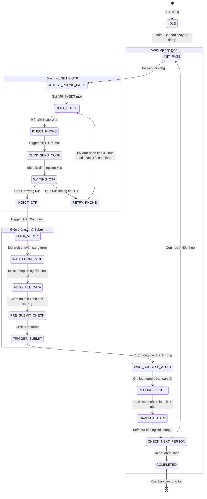

# THIẾT KẾ KIẾN TRÚC & FLOW TỰ ĐỘNG HÓA HOÀN TOÀN (FULL AUTOMATION)
## Dự Án: Abbott Event Auto-Pilot Bot

> **Mục tiêu:** Nâng cấp ứng dụng từ chế độ bán tự động (Semi-Automated) hiện tại thành **Chế độ Tự động hoàn toàn (Full Automation / 1-Click Batch Run)**: Người dùng chỉ cần dán danh sách và bấm **"BẮT ĐẦU CHẠY TỰ ĐỘNG"**, máy sẽ tự động thuê số, gửi mã, nhận OTP, xác thực, điền thông tin, gửi form và lặp lại cho toàn bộ danh sách mà không cần bất kỳ can thiệp thủ công nào.

---

## 1. MÁY TRẠNG THÁI TỰ ĐỘNG (FINITE STATE MACHINE - FSM)

Để quá trình tự động hoạt động ổn định, không bị nghẽn (deadlock) hoặc xung đột trang, toàn bộ luồng được điều khiển bởi một State Machine chạy ngầm:



---

## 2. SEQUENCE DIAGRAM (LUỒNG GIAO TIẾP GIỮA CÁC THÀNH PHẦN)

Biểu đồ tuần tự mô tả sự tương tác giữa: **Automation Controller (App)**, **OTP Service (ViOTP/HupSMS)**, và **WebView (Website Abbott)**:

```mermaid
sequenceDiagram
    autonumber
    actor User as Người dùng
    participant Ctrl as Automation Controller (Flutter)
    participant OTP as OTP Service API (HupSMS/ViOTP)
    participant Web as WebView / DOM JS

    User->>Ctrl: Bấm "BẮT ĐẦU CHẠY TỰ ĐỘNG"
    Ctrl->>Web: Load URL sự kiện Abbott
    Web-->>Ctrl: DOMReady / URL matched

    loop Cho từng người trong danh sách (1..N)
        Note over Ctrl,Web: GIAI ĐOẠN 1: THUÊ SỐ & XÁC THỰC OTP
        Ctrl->>OTP: rentPhone(serviceId: 247)
        OTP-->>Ctrl: Trả về Phone: 0593358343, orderId
        Ctrl->>Web: JS: Set SĐT & dispatchEvent('input')
        Ctrl->>Web: JS: Click nút "Gửi mã xác thực"
        Web-->>Ctrl: Bắt đầu đếm 60s trên Web
        
        rect rgb(20, 30, 45)
            Note over Ctrl,OTP: POLLING OTP ĐỊNH KỲ (2.5s)
            loop Đếm ngược 60s
                Ctrl->>OTP: checkOtp(orderId)
                alt Có OTP về (status == success)
                    OTP-->>Ctrl: Code: 286992
                else Chưa có (pending)
                    OTP-->>Ctrl: pending...
                end
            end
        end

        alt Trường hợp 1: Nhận được OTP trong 60s
            Ctrl->>Web: JS: Set OTP & dispatchEvent('input')
            Ctrl->>Web: JS: Click nút "Xác thực / Tiếp tục"
        else Trường hợp 2: Quá 60s không có OTP
            Ctrl->>OTP: cancelRental(orderId) -> Hoàn tiền 100%
            Ctrl->>Web: JS: Click gửi lại hoặc reload trang
            Note over Ctrl: Thử lại số khác (Retry Count < 3)
        end

        Note over Ctrl,Web: GIAI ĐOẠN 2: ĐIỀN FORM & GỬI DỮ LIỆU
        Web-->>Ctrl: Observer phát hiện Form cá nhân xuất hiện
        Ctrl->>Web: JS: Điền Họ tên, Khoa, Chức danh, BV, Checkbox
        Ctrl->>Web: JS: Validate các trường (Đảm bảo không lỗi)
        
        opt Tùy chọn an toàn (Human-in-the-loop)
            Ctrl->>Ctrl: Đợi delay 2-3s (Giả lập thao tác người thật)
        end
        
        Ctrl->>Web: JS: Click nút "Gửi / Submit"
        Web-->>Ctrl: Web hiện "Đăng ký thành công"

        Note over Ctrl,Web: GIAI ĐOẠN 3: GHI LOG & CHUYỂN TIẾP
        Ctrl->>Ctrl: Đánh dấu người thứ i: THÀNH CÔNG
        Ctrl->>Web: Go Back về trang nhập SĐT ban đầu (hoặc reload URL)
        Ctrl->>Ctrl: Next Person: index = index + 1
    end

    Ctrl->>User: Thông báo: "Đã hoàn thành toàn bộ N người!" kèm Báo cáo
```



---

## 3. CÁC ĐOẠN JAVASCRIPT AUTOMATION TRỌNG YẾU CẦN TRIỂN KHAI

Để Flutter có thể điều khiển WebView mượt mà, cần xây dựng các module JavaScript chuyên dụng (inject ngầm):

### 3.1. Nhận diện trạng thái trang (Page State Detector)
```javascript
// Kiểm tra trang hiện tại là trang Nhập SĐT hay trang Form cá nhân
function detectCurrentPage() {
  const hasPhoneInput = document.querySelector('input[type="tel"], input[placeholder*="thoại"], input[name*="phone"]') !== null;
  const hasOtpInput = document.querySelector('input[placeholder*="OTP"], input[placeholder*="mã"], input[name*="otp"]') !== null;
  const hasNameInput = document.querySelector('input[placeholder*="tên"], input[name*="name"], input[name*="fullname"]') !== null;
  
  if (hasNameInput) return 'FORM_PAGE';
  if (hasOtpInput) return 'OTP_PAGE';
  if (hasPhoneInput) return 'PHONE_PAGE';
  return 'UNKNOWN';
}
```

### 3.2. Tự động điền & Kích hoạt sự kiện (Event Dispatcher)
```javascript
function setInputValue(input, value) {
  if (!input) return false;
  input.focus();
  input.value = value;
  // Bắt buộc kích hoạt đầy đủ các sự kiện để React/Angular/Vue nhận giá trị
  input.dispatchEvent(new Event('input', { bubbles: true }));
  input.dispatchEvent(new Event('change', { bubbles: true }));
  input.dispatchEvent(new Event('blur', { bubbles: true }));
  return true;
}
```

### 3.3. Tự động tìm và bấm nút (Smart Button Clicker)
```javascript
function clickButtonByText(regexPattern) {
  const buttons = Array.from(document.querySelectorAll('button, a, div[role="button"], input[type="button"], input[type="submit"]'));
  for (const btn of buttons) {
    const text = (btn.innerText || btn.textContent || btn.value || '').trim().toLowerCase();
    if (regexPattern.test(text) && btn.offsetParent !== null && !btn.disabled) {
      btn.click();
      return true;
    }
  }
  return false;
}

// Ví dụ:
// Bấm gửi mã: clickButtonByText(/gửi mã|lấy mã|nhận otp/i);
// Bấm xác thực: clickButtonByText(/xác thực|tiếp tục|đồng ý/i);
// Bấm submit form: clickButtonByText(/gửi|hoàn tất|đăng ký/i);
```

### 3.4. Giám sát thay đổi DOM (MutationObserver)
Dùng để phát hiện tức thì khi popup hiện lên, khi website load xong hoặc khi có thông báo "Đăng ký thành công" mà không cần sleep/delay cứng:
```javascript
function waitForElement(selector, timeoutMs = 10000) {
  return new Promise((resolve, reject) => {
    const el = document.querySelector(selector);
    if (el) return resolve(el);
    
    const timer = setTimeout(() => {
      observer.disconnect();
      reject(new Error('Timeout waiting for ' + selector));
    }, timeoutMs);

    const observer = new MutationObserver(() => {
      const el = document.querySelector(selector);
      if (el) {
        clearTimeout(timer);
        observer.disconnect();
        resolve(el);
      }
    });

    observer.observe(document.body, { childList: true, subtree: true });
  });
}
```

---

## 4. CÁC TÍNH NĂNG AN TOÀN & KIỂM SOÁT (SAFETY CONTROLS)

Khi chuyển sang chạy tự động hoàn toàn, hệ thống bắt buộc phải có các lớp bảo vệ:

1. **Cơ chế Dừng Khẩn Cấp (Emergency Stop):**
   - Nút nổi **`[ ⏸ TẠM DỪNG ]`** và **`[ ⏹ HỦY BỎ ]`** luôn ghim ở góc màn hình.
   - Khi bấm Tạm dừng, bot dừng lại ngay ở bước hiện tại, cho phép người dùng kiểm tra hoặc thao tác tay.

2. **Cơ chế Retry & Failover thông minh:**
   - **Khi quá 60s không có OTP:** Bot tự động gọi API `cancelRental` để hoàn lại tiền vào tài khoản HupSMS, sau đó thuê số mới. Tối đa thử lại 3 lần cho 1 người. Nếu sau 3 lần vẫn lỗi thì ghi log `Thất bại` và tự động chuyển sang người kế tiếp.
   - **Khi Server bị hết số:** Nếu Server 247 báo `NO_NUMBER_AVAILABLE`, bot tự động chuyển sang Server 3 -> Server 2 để tiếp tục công việc.

3. **Mô phỏng hành vi tự nhiên (Human-like Delays):**
   - Chèn khoảng nghỉ ngẫu nhiên (jitter `1200ms` - `2500ms`) giữa các thao tác gõ phím và click nút để tránh bị hệ thống website chặn IP do tần suất request quá nhanh.

4. **Tùy chọn "Xác nhận trước khi gửi" (Semi-Auto Safeguard):**
   - Công tắc cấu hình: *Dừng lại 3 giây trước khi bấm nút Gửi Form cuối cùng để người dùng kịp quan sát*.

---

## 5. THIẾT KẾ CƠ SỞ DỮ LIỆU & BÁO CÁO KẾT QUẢ (RUN LOGS)

Sau khi hoàn thành đợt chạy tự động (Batch Run), ứng dụng sẽ lưu và hiển thị bảng tổng kết:

| STT | Họ và tên | SĐT đã dùng | OTP | Khoa / Chức danh | Thời gian | Chi phí | Trạng thái |
|:---:|---|:---:|:---:|---|:---:|:---:|:---:|
| 1 | Huỳnh Thị Việt Trinh | 0593358343 | 286992 | Ngoại Tổng Hợp / Điều dưỡng | 38s | 1.500 đ | ✅ Thành công |
| 2 | Nguyễn Văn An | 0981234567 | 114422 | Gây Mê Hồi Sức / Bác sĩ | 42s | 1.500 đ | ✅ Thành công |
| 3 | Trần Thị Bình | 0912345678 | — | Khoa Dược / Dược sĩ | 65s | 0 đ (Hoàn tiền) | ⚠️ Lỗi OTP (Đã thử 3 lần) |

- **Nút xuất Excel/CSV:** Cho phép xuất file báo cáo để gửi cho ban tổ chức hoặc kế toán đối soát chi phí thuê SIM.

---

## 6. LỘ TRÌNH TRIỂN KHAI KỸ THUẬT (ROADMAP)

- **Giai đoạn 1 (Hiện tại - Đã xong v1.4.0):** 
  - Đa nguồn ViOTP & HupSMS, chọn Server, đếm ngược 60s, Auto-fill bán tự động bằng 1 nút bấm (`Alt + F`).
- **Giai đoạn 2 (Auto OTP & Auto Verify):**
  - Tự động điền SĐT ngay khi thuê số xong.
  - Tự động điền OTP và tự bấm nút "Xác thực" ngay khi mã về (bỏ thao tác copy-paste).
- **Giai đoạn 3 (Full Batch Runner):**
  - Tích hợp State Machine hoàn chỉnh.
  - Thêm nút **`[ 🚀 BẮT ĐẦU CHẠY TỰ ĐỘNG ]`** với thanh tiến trình `Đang chạy: 3/20 người...`.
  - Báo cáo kết quả và xuất file Excel.
