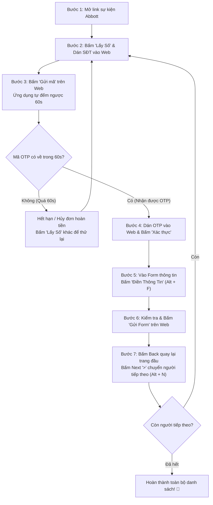

# HƯỚNG DẪN SỬ DỤNG VÀ QUY TRÌNH VẬN HÀNH CHUẨN (SOP)
## Ứng Dụng Hỗ Trợ Đăng Ký Sự Kiện Abbott (Abbott Event Helper)

---

## MỤC LỤC
1. [Tổng quan về ứng dụng](#1-tổng-quan-về-ứng-dụng)
2. [Thiết lập ban đầu (Cài đặt Token, Server & Bệnh viện)](#2-thiết-lập-ban-đầu)
   - [2.1. Cách lấy Token ViOTP](#21-cách-lấy-token-viotp)
   - [2.2. Cách lấy API Key HupSMS](#22-cách-lấy-api-key-hupsms)
   - [2.3. Kiểm tra số dư & Chọn Server](#23-kiểm-tra-số-dư--chọn-server)
   - [2.4. Quản lý Profile Bệnh viện](#24-quản-lý-profile-bệnh-viện)
   - [2.5. Nhập danh sách người tham gia](#25-nhập-danh-sách-người-tham-gia)
   - [2.6. Cấu hình bật/tắt trường tự điền & Độ trễ](#26-cấu-hình-bậttắt-trường-tự-điền--độ-trễ)
3. [Quy trình thao tác chuẩn từng bước (SOP)](#3-quy-trình-thao-tác-chuẩn-từng-bước-sop)
   - [Bước 1: Mở link sự kiện Abbott](#bước-1-mở-link-sự-kiện-abbott)
   - [Bước 2: Thuê số điện thoại & Dán vào web](#bước-2-thuê-số-điện-thoại--dán-vào-web)
   - [Bước 3: Bấm gửi mã trên web & Đếm ngược 60s](#bước-3-bấm-gửi-mã-trên-web--đếm-ngược-60s)
   - [Bước 4: Nhận mã OTP & Bấm Xác thực](#bước-4-nhận-mã-otp--bấm-xác-thực)
   - [Bước 5: Điền thông tin người tham dự](#bước-5-điền-thông-tin-người-tham-dự)
   - [Bước 6: Kiểm tra & Gửi form đăng ký](#bước-6-kiểm-tra--gửi-form-đăng-ký)
   - [Bước 7: Quay lại trang đầu & Chuyển người tiếp theo](#bước-7-quay-lại-trang-đầu--chuyển-người-tiếp-theo)
4. [Bảng phím tắt nhanh trên Windows](#4-bảng-phím-tắt-nhanh-trên-windows)
5. [Xử lý sự cố thường gặp (FAQ)](#5-xử-lý-sự-cố-thường-gặp-faq)

---

## 1. TỔNG QUAN VỀ ỨNG DỤNG

**Abbott Event Helper** là ứng dụng trợ lý chuyên dụng giúp tự động hóa quy trình nhập liệu đăng ký tham dự hội thảo, sự kiện của Abbott.

### Điểm mấu chốt cần ghi nhớ:
- Ứng dụng hỗ trợ song song 2 nhà cung cấp SIM/OTP: **ViOTP** và **HupSMS**.
- Ứng dụng **không tự động gửi form submit** mà chỉ tự động điền (Auto-fill) các thông tin theo chuẩn dữ liệu đã cấu hình. Bạn luôn là người kiểm tra cuối cùng và nhấn gửi để đảm bảo độ chính xác 100%.
- Cơ chế bảo toàn chi phí: Tự động đếm ngược 60 giây (chuẩn thời gian chờ của website Abbott). Nếu sau 60s không có mã, hệ thống tự hủy đơn để **hoàn lại tiền ngay lập tức** (đối với HupSMS).

---

## 2. THIẾT LẬP BAN ĐẦU

Bạn chỉ cần thực hiện thiết lập này một lần khi mới cài đặt ứng dụng. Các thông tin sẽ được tự động lưu lại trong bộ nhớ máy.

Bấm vào biểu tượng **Bánh răng / Cài đặt** ở góc trên cùng bên phải để mở popup **Quản lý Cài đặt & Dữ liệu**.

---

### 2.1. Cách lấy Token ViOTP
1. Truy cập trang web chính thức: [https://viotp.net](https://viotp.net) và đăng nhập tài khoản.
2. Nạp một khoản tiền nhỏ vào tài khoản ViOTP.
3. Vào mục **Cài đặt tài khoản** (hoặc **Thông tin tài khoản** / **API Key**).
4. Sao chép chuỗi mã Token (gồm 32 ký tự).
5. Mở ứng dụng, vào **Cài đặt** -> chọn Tab **Cấu hình** -> dán chuỗi token vào ô **ViOTP Token (Bearer)**.
6. Bấm nút **Dò ViOTP** để hệ thống tự động tìm mã dịch vụ Abbott.

---

### 2.2. Cách lấy API Key HupSMS
1. Truy cập trang web chính thức: [https://hupsms.com](https://hupsms.com) và đăng nhập tài khoản.
2. Nạp tiền vào tài khoản HupSMS.
3. Vào trang cá nhân: [https://hupsms.com/profile](https://hupsms.com/profile).
4. Tại mục **API Key**, nhấn nút **Tạo API Key** (nếu chưa có) và bấm biểu tượng sao chép.
5. Mở ứng dụng, vào **Cài đặt** -> chọn Tab **Cấu hình** -> dán API Key vào ô **HupSMS API Key**.
6. Bấm nút **Dò HupSMS** để lấy danh sách dịch vụ Abbott.

---

### 2.3. Kiểm tra số dư & Chọn Server
- **Kiểm tra số dư:** Số dư sẽ hiển thị trực tiếp trên thanh Header (ví dụ: `HupSMS: 21.500 đ` hoặc `ViOTP: 50.000 đ`). Bạn có thể bấm vào huy hiệu số dư bất cứ lúc nào để làm mới.
- **Chọn Server HupSMS:** 
  - HupSMS cung cấp dịch vụ Abbott trên nhiều Server với mức giá khác nhau:
    - `Abbott [Server 247]` — **1.500 đ** ⭐ *(Khuyên dùng - Rẻ nhất)*
    - `Abbott [Server 3]` — **1.800 đ**
    - `Abbott [Server 2]` — **3.500 đ**
  - Khi bấm **Dò HupSMS**, ứng dụng sẽ tự động chọn Server 247 (1.500 đ). Nếu Server 247 hết số SIM, ứng dụng sẽ hiện danh sách để bạn chọn chuyển sang Server 3 hoặc Server 2.
  - Ngay trên màn hình chính cũng có nút **`[ 🌐 Server ID: ... ▾ ]`**, bạn chỉ cần bấm vào là có thể đổi Server trong vòng 1 giây.

---

### 2.4. Quản lý Profile Bệnh viện
Vào **Cài đặt** -> chọn Tab **Bệnh Viện**:
- **Danh sách Bệnh viện:** Nơi lưu các bệnh viện hay sử dụng. Bạn có thể thêm từng bệnh viện hoặc bấm nút **Nhập nhiều** để dán danh sách nhiều bệnh viện cùng lúc.
- **Chọn Bệnh viện mặc định:** Bấm chọn radio button vào bệnh viện đang cần làm sự kiện.
- **Áp dụng cho tất cả:** Bấm nút **Gán BV cho tất cả DS** để gán tên bệnh viện này cho toàn bộ danh sách người tham gia chỉ với 1 click.

---

### 2.5. Nhập danh sách người tham gia
Vào **Cài đặt** -> chọn Tab **DS Người**:
1. Dán danh sách thô vào khung văn bản lớn.
2. Mỗi người nằm trên một dòng theo định dạng chuẩn:
   ```text
   Họ và tên - Khoa/Phòng ban - Chức danh [- Tên bệnh viện]
   ```
   *Ví dụ:*
   ```text
   Huỳnh thị việt trinh - Khoa Ngoại Tổng Hợp - Y tá/ Điều dưỡng
   Nguyễn Văn An - Khoa Phẫu Thuật Gây Mê Hồi Sức - Bác Sĩ Điều Trị - Bệnh Viện Đa Khoa Tỉnh Quảng Ngãi
   Trần Thị Bình - Khoa Khác - Điều Dưỡng Trưởng
   ```
3. Bấm nút **Chuyển đổi dữ liệu**:
   - Ứng dụng sẽ tự động tách tên, tự động chuẩn hóa tiếng Việt không dấu/có dấu, chuẩn hóa tên Khoa theo danh mục Abbott (`Khoa Noi Tim Mach`, `Khoa Phau Thuat Gay Me - Hoi Suc`, `Khoa Duoc`,...).
   - Nếu dòng không ghi tên bệnh viện, ứng dụng tự động lấy Bệnh viện mặc định đã chọn ở Profile.
4. Bấm **Lưu Thay Đổi** ở góc dưới popup.

---

### 2.6. Cấu hình bật/tắt trường tự điền & Độ trễ
Vào **Cài đặt** -> chọn Tab **Cấu hình** -> kéo xuống mục **Cấu hình trường tự điền & Độ trễ**:
- **Bật/Tắt từng trường:** Nếu form web Abbott không yêu cầu trường nào (ví dụ không cần điền chức danh), bạn có thể tắt công tắc trường đó.
- **Độ trễ (ms):** Mặc định là `700ms`. Đây là khoảng thời gian chờ giữa các lần gõ phím ảo và mở menu dropdown trên web để trang web kịp kích hoạt sự kiện JavaScript (Angular/React). Nếu mạng yếu hoặc máy chậm, bạn có thể tăng lên `1000ms` - `1200ms`.

---

## 3. QUY TRÌNH THAO TÁC CHUẨN TỪNG BƯỚC (SOP)

Sau khi đã thiết lập xong Token và Danh sách người, đây là quy trình thao tác lặp lại cho từng người tham gia:



---

### Bước 1: Mở link sự kiện Abbott
1. Sao chép đường link đăng ký sự kiện Abbott do ban tổ chức cung cấp.
2. Dán link vào ô địa chỉ ở đỉnh màn hình (bên phải trên Desktop, hoặc trên thanh URL trên Mobile).
3. Nhấn **Enter** (hoặc bấm biểu tượng mũi tên) để trang web Abbott tải trong khung WebView.

---

### Bước 2: Thuê số điện thoại & Dán vào web
1. Kiểm tra nhà cung cấp đang chọn (`ViOTP` hoặc `HupSMS`) và Server ID.
2. Bấm nút **`[ 📱 Lấy Số ]`**:
   - Ứng dụng gọi API thuê số điện thoại mới.
   - Số điện thoại nhận được sẽ tự động chuẩn hóa về đầu số `0` (ví dụ: `0593358343`).
   - Ứng dụng **tự động sao chép SĐT vào bộ nhớ tạm (Clipboard)**.
3. Nhấp chuột vào ô **Số điện thoại** trên trang web Abbott và nhấn **`Ctrl + V`** (hoặc Dán).

---

### Bước 3: Bấm gửi mã trên web & Đếm ngược 60s
1. Trên website Abbott, bấm nút **Gửi mã xác thực** (hoặc Nhận mã OTP).
2. Ngay lập tức, trên ứng dụng:
   - Nút **`[ ✉ Lấy OTP ]`** tự động kích hoạt tiến trình kiểm tra (Polling) định kỳ mỗi 2.5 giây.
   - Đồng hồ đếm ngược bắt đầu chạy từ **`60s`** lùi dần về 0.
3. ⚠️ **Quy tắc 60 giây quan trọng:**
   - Hệ thống của Abbott chỉ chờ mã trong vòng 60 giây. Sau 60 giây nếu tin nhắn không về thì số đó sẽ không thể nhận được nữa.
   - Nếu hết 60 giây mà chưa có OTP: 
     - Ứng dụng sẽ tự động dừng chờ và báo hết hạn.
     - Nếu đang dùng **HupSMS**, ứng dụng tự động gọi lệnh hủy đơn hoàn tiền 100% vào tài khoản của bạn.
     - Bạn chỉ cần bấm lại nút **`[ 📱 Lấy Số ]`** để lấy số mới và yêu cầu gửi lại mã trên web.

---

### Bước 4: Nhận mã OTP & Bấm Xác thực
1. Khi tin nhắn chứa mã OTP về máy chủ:
   - Ứng dụng tự động bắt mã (ví dụ: `286992`).
   - Ứng dụng **tự động sao chép mã OTP vào Clipboard**.
   - Có chuông/rung hoặc thông báo hoàn tất trên thanh trạng thái.
2. Nhấp chuột vào ô **Mã xác thực (OTP)** trên website Abbott và nhấn **`Ctrl + V`** (Dán).
3. Bấm nút **Xác thực / Tiếp tục** trên website Abbott để đăng nhập vào trang điền thông tin chi tiết.

---

### Bước 5: Điền thông tin người tham dự
1. Lúc này, website Abbott chuyển sang màn hình form điền thông tin cá nhân.
2. Nhìn sang bảng bên trái của ứng dụng: Đảm bảo thẻ người tham gia đang hiển thị đúng người bạn muốn điền (ví dụ: `#1/9 Huỳnh thị việt trinh`).
3. Bấm nút **`[ 🪄 Điền Thông Tin ]`** (hoặc bấm tổ hợp phím **`Alt + F`** trên bàn phím):
   - Ứng dụng sẽ tự động điền:
     - **Họ và tên**: Điền đầy đủ có dấu hoặc không dấu theo cấu hình.
     - **Khoa / Phòng ban**: Tự động mở menu và chọn đúng Khoa (hoặc điền ô Khoa Khác nếu chọn Khác).
     - **Chức danh**: Tự động chọn Bác sĩ điều trị / Điều dưỡng / Dược sĩ...
     - **Bệnh viện**: Tự động chọn đúng bệnh viện trong profile.
     - **Checkbox Đồng ý**: Tự động tích chọn đồng ý các điều khoản.

---

### Bước 6: Kiểm tra & Gửi form đăng ký
1. Dành 1-2 giây quan sát nhanh các trường trên web xem đã đầy đủ và tích xanh chưa.
2. Bấm nút **Gửi Form** (hoặc nút Submit màu xanh/hồng trên website Abbott) để hoàn thành việc đăng ký cho người hiện tại.
3. Màn hình web hiện thông báo *"Đăng ký thành công"* hoặc chuyển sang màn hình cảm ơn.

---

### Bước 7: Quay lại trang đầu & Chuyển người tiếp theo
1. Bấm nút **Quay lại** (biểu tượng mũi tên `←` trên thanh điều hướng hoặc nhấn **`Alt + Mũi tên Trái`**) để trở về trang nhập SĐT ban đầu.
2. Trên ứng dụng, bấm nút mũi tên **`>`** (hoặc nhấn **`Alt + N`**) để chuyển sang người tham dự tiếp theo (`#2/9`, `#3/9`...).
3. Lặp lại từ **Bước 2** cho người mới. Tiếp tục quy trình cho đến khi hoàn thành người cuối cùng trong danh sách!

---

## 4. BẢNG PHÍM TẮT NHANH TRÊN WINDOWS

Để tối ưu tốc độ thao tác, trên phiên bản máy tính Windows bạn nên tận dụng các phím tắt sau:

| Phím tắt | Chức năng | Mô tả |
|---|---|---|
| **`Alt + F`** | **Tự động điền Form** | Kích hoạt Auto-fill thông tin người hiện tại vào trang web |
| **`Alt + N`** | **Người tiếp theo (Next)** | Chuyển sang người tiếp theo trong danh sách |
| **`Alt + P`** | **Người trước đó (Prev)** | Quay lại người phía trước trong danh sách |
| **`Alt + ←`** | **Quay lại (Back web)** | Trở về trang trước của trình duyệt nhúng |
| **`Alt + →`** | **Tiến tới (Forward web)**| Đi tiếp trang kế tiếp của trình duyệt nhúng |
| **`F5`** | **Tải lại trang (Reload)** | Làm mới lại trang web sự kiện |
| **`Ctrl + V`** | **Dán dữ liệu** | Dán nhanh SĐT hoặc OTP vừa được app copy tự động |

> 💡 **Mẹo:** Ngoài ra, trên ứng dụng có khu vực **"Sao chép nhanh 1-chạm"** ở góc dưới. Bạn chỉ cần click chuột vào bất kỳ ô nào (`Họ tên`, `SĐT`, `OTP`, `BV`, `Khoa`, `Chức danh`) là dữ liệu đó sẽ được copy ngay lập tức để bạn dán thủ công nếu cần.

---

## 5. XỬ LÝ SỰ CỐ THƯỜNG GẶP (FAQ)

### ❓ 1. Thuê số bị báo lỗi "Hết số" hoặc "Không có số khả dụng"?
- **Cách xử lý:** 
  - Nếu đang dùng **HupSMS**: Bấm vào nút **`[ 🌐 Server ID: ... ▾ ]`** ngay trên màn hình chính, đổi sang Server khác (ví dụ: chuyển từ Server 247 sang Server 3 hoặc Server 2).
  - Hoặc chuyển hẳn sang dùng nguồn **ViOTP** bằng nút gạt `[ ViOTP | HupSMS ]`.

### ❓ 2. Quá 60 giây không thấy mã OTP về?
- Website Abbott có thời gian timeout là 60 giây. Sau 60s mã sẽ không gửi về nữa.
- Hãy bấm nút **Hủy/Dừng chờ** (nếu dùng HupSMS, tiền sẽ được hoàn trả tự động vào tài khoản).
- Bấm lại nút **Lấy Số** để thuê số mới và gửi lại mã trên web.

### ❓ 3. Bấm "Điền Thông Tin" mà web không nhận dữ liệu?
- Hãy đảm bảo trang web đã tải xong hoàn toàn trước khi bấm điền.
- Vào **Cài đặt** -> Tab **Cấu hình** -> Tăng độ trễ (`delay`) từ `700ms` lên `1000ms` hoặc `1200ms` để website kịp phản hồi với sự kiện JavaScript.
- Nếu một dropdown nào đó không tự nhảy, bạn có thể click vào nút copy nhanh ở mục **Sao chép nhanh 1-chạm** để dán thủ công.

### ❓ 4. Làm sao để chia sẻ ứng dụng cho người khác dùng trên máy khác?
- Bạn chỉ cần gửi file nén **`abbott_helper-windows-x64.zip`** (tải từ mục Releases trên GitHub).
- Người nhận chỉ cần giải nén file zip ra một thư mục bất kỳ và nhấp đúp vào **`abbott_helper.exe`** là có thể sử dụng ngay mà không cần cài đặt thêm bất kỳ phần mềm nào.
